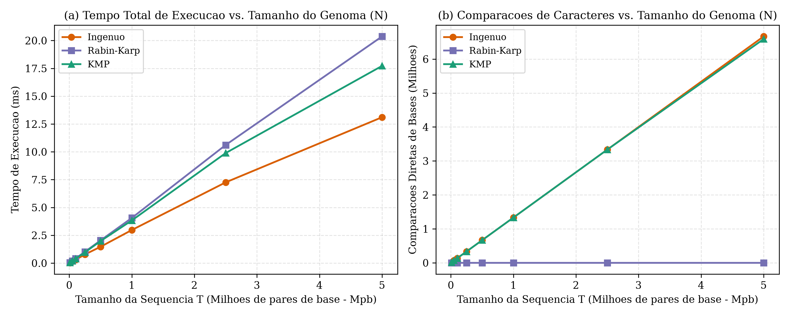
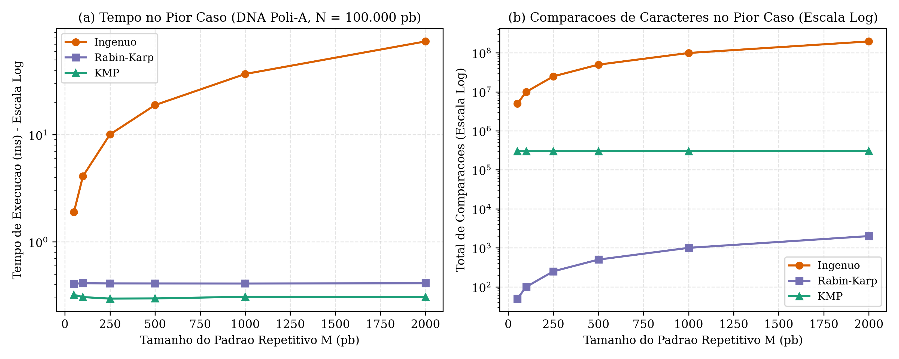
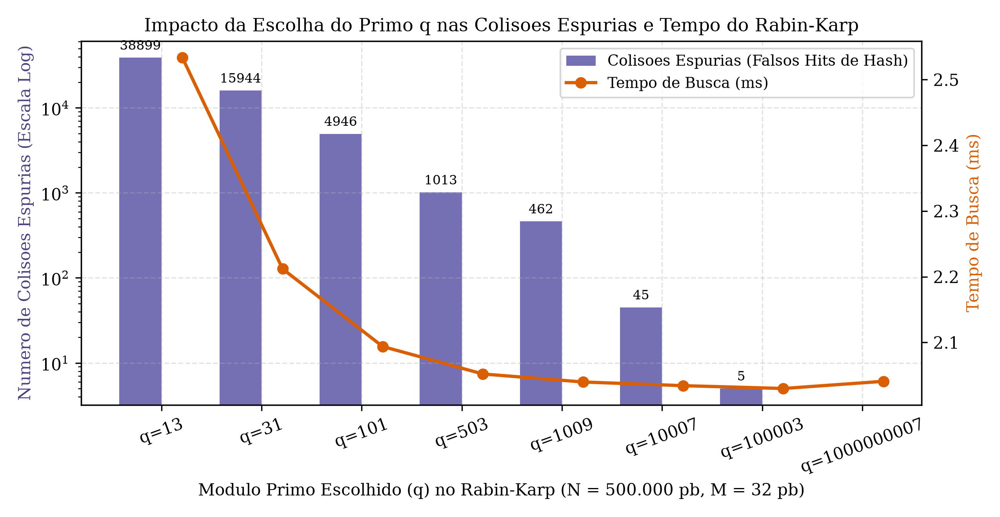

# Casamento de Cadeias em Sequencias Genomicas: Algoritmos de Rabin-Karp e Knuth-Morris-Pratt (KMP)

<p align="left">
  <a href="https://github.com/ImArthz/Aeds2_casamento_de_cadeias/releases/latest/download/relatorio_casamento_cadeias.pdf">
    
  </a>
  <a href="https://raw.githack.com/ImArthz/Aeds2_casamento_de_cadeias/main/docs/seminario/simulador_interativo.html">
    </a> <a href="https://github.com/ImArthz/Aeds2_casamento_de_cadeias/releases/latest/download/simulador_interativo.html">
  </a>
  <a href="https://github.com/ImArthz/Aeds2_casamento_de_cadeias/actions/workflows/build_and_latex.yml">
    
  </a>
</p>

Trabalho Teorico-Pratico desenvolvido para a disciplina de **Algoritmos e Estruturas de Dados II / Projeto e Analise de Algoritmos** do curso de Engenharia da Computacao no **CEFET-MG (Campus Divinopolis)**, sob orientacao do **Prof. Dr. Michel Pires da Silva**.

O projeto investiga o paradigma de casamento exato de cadeias (*String Matching*, Capitulo 32 de Cormen et al.) atraves da implementacao em **C++17** dos algoritmos **Ingenuo (Forca Bruta)**, **Rabin-Karp** (*Rolling Hash* modular) e **Knuth-Morris-Pratt (KMP)**, avaliando suas implicacoes praticas na busca de motivos regulatorios, iniciadores de PCR (*primers*) e na etapa de semeacao (*seeding* de $k$-mers) para alinhamento genetico.

---

## Autores (Grupo - Tema 5)

- **Integrante 1:** Arthur de Oliveira Mendonca
- **Integrante 2:** Italo Xavier Fonseca
- **Integrante 3:** Thiago Augusto Silva Martins
- **Integrante 4:** Thales Guerreiro
- **Integrante 5:** Matheus Tavares

---

## Estrutura do Repositorio

```text
Aeds2_casamento_de_cadeias/
├── include/
│   ├── casamento_cadeias.hpp     # Interfaces de Busca Ingenua, Rabin-Karp, KMP e Seeding
│   └── fasta_io.hpp              # Leitor de arquivos FASTA e geradores de sequencias de DNA
├── src/
│   ├── casamento_cadeias.cpp     # Implementacao em C++17 fiel ao Cap. 32 do Cormen (CLRS)
│   ├── fasta_io.cpp              # Manipulacao de sequencias biologicas e casos patologicos
│   └── main.cpp                  # Suite de experimentos no genoma SARS-CoV-2 e benchmarks
├── data/
│   ├── sars_cov2_NC_045512.fasta # Genoma completo do SARS-CoV-2 (NCBI RefSeq, 29.903 pb)
│   └── tp53_NM_000546.fasta      # Transcrito mRNA do gene TP53 humano (NCBI RefSeq, 2.512 pb)
├── benchmarks/
│   ├── gerar_graficos.py         # Script de plotagem dos experimentos (Matplotlib)
│   ├── resultados_genoma_real.csv
│   ├── resultados_escala_n.csv
│   ├── resultados_pior_caso.csv
│   └── resultados_colisoes_rk.csv
├── docs/
│   ├── relatorio_latex/
│   │   ├── relatorio_casamento_cadeias.tex  # Monografia completa em LaTeX + Cheat Sheet
│   │   ├── tempo_escala_n.png
│   │   ├── pior_caso_repetitivo.png
│   │   ├── colisoes_rabin_karp.png
│   │   └── comparacoes_genoma_sars.png
│   └── seminario/
│       ├── ROTEIRO_AULA_40MIN.md            # Plano de aula dividido para os 5 integrantes
│       └── simulador_interativo.html        # Visualizador passo a passo para o seminario
└── Makefile
```

---

## Compilacao e Execucao (C++17)

### Compilando com `make` ou `g++`
Na raiz do repositorio, execute:

```bash
make
./bin/casamento_cadeias
```

Ou diretamente via linha de comando com `g++`:

```bash
mkdir -p bin benchmarks
g++ -std=c++17 -O3 -Wall -Wextra -Iinclude src/main.cpp src/casamento_cadeias.cpp src/fasta_io.cpp -o bin/casamento_cadeias
./bin/casamento_cadeias
```

### Regerando os Graficos a partir dos CSVs
```bash
python benchmarks/gerar_graficos.py
```

---

## Sintese dos Resultados Experimentais

### 1. Busca de Padroes Reais no Genoma do SARS-CoV-2 (`NC_045512.2` - 29.903 pb)

| Padrao Biologico | Tamanho ($m$) | Algoritmo | Ocorrencias | Comparacoes de Bases | Colisoes Espurias | Tempo Total (ms) |
| :--- | :---: | :--- | :---: | :---: | :---: | :---: |
| **Motif TATA-box** (`TATAAA`) | 6 | Ingenuo | 20 | 42.688 | 0 | 0,1137 |
| **Motif TATA-box** (`TATAAA`) | 6 | Rabin-Karp ($q=10^9+7$) | 20 | 120 | 0 | 0,1226 |
| **Motif TATA-box** (`TATAAA`) | 6 | Rabin-Karp ($q=101$) | 20 | 412 | 197 | 0,1254 |
| **Motif TATA-box** (`TATAAA`) | 6 | KMP | 20 | 42.503 | 0 | 0,1336 |
| **Primer OMS RdRp-F2** | 22 | Ingenuo | 1 | 38.495 | 0 | 0,0818 |
| **Primer OMS RdRp-F2** | 22 | Rabin-Karp ($q=10^9+7$) | 1 | 22 | 0 | 0,1212 |
| **Primer OMS RdRp-F2** | 22 | KMP | 1 | 38.403 | 0 | 0,1084 |
| **Cauda Poli-A** (`A`$\times 25$) | 25 | Ingenuo | 9 | 43.065 | 0 | 0,0906 |
| **Cauda Poli-A** (`A`$\times 25$) | 25 | Rabin-Karp ($q=10^9+7$) | 9 | 225 | 0 | 0,1217 |
| **Cauda Poli-A** (`A`$\times 25$) | 25 | KMP | 9 | 41.751 | 0 | 0,1562 |

### 2. Seeding de $k$-mers em Leitura com Mutacoes (SNPs)
Ao extrair uma leitura de $120$ pb do inicio do gene *Spike* (posicao $21.562$) contendo $2$ mutacoes pontuais (SNPs nas posicoes $35$ e $88$), o casamento exato da leitura inteira retorna $0$ ocorrencias. Empregando a etapa de *seeding* via *rolling hash* de Rabin-Karp com sementes de $k = 15$ pb (`seeding_rabin_karp`), o algoritmo localiza $76$ ancoras exatas nas sub-regioes preservadas, identificando imediatamente o deslocamento original $s = 21.562$ para alinhamento local.

### 3. Graficos de Desempenho Assintotico

#### Escalabilidade Linear ($N$ ate $5 \times 10^6$ pb, $M = 64$)


#### Pior Caso em DNA Repetitivo Homopolimerico (`AAAAA...AC`, $N = 100.000$ pb)


#### Impacto da Escolha do Primo $q$ nas Colisoes Espurias do Rabin-Karp


---

## Relatorio Tecnico em LaTeX (Download PDF)

O codigo-fonte completo do relatorio tecnico (redigido com o pacote `algorithm2e`, diagramas em TikZ e o Apendice *Cheat Sheet*) encontra-se em [`docs/relatorio_latex/relatorio_casamento_cadeias.tex`](docs/relatorio_latex/relatorio_casamento_cadeias.tex). A cada *push* na branch `main`, o workflow do GitHub Actions compila automaticamente o PDF final e publica na aba **Releases** do repositorio:

<p align="left">
  <a href="https://github.com/ImArthz/Aeds2_casamento_de_cadeias/releases/latest/download/relatorio_casamento_cadeias.pdf">
    
  </a>
</p>

---

## Referencias Principais

1. CORMEN, T. H.; LEISERSON, C. E.; RIVEST, R. L.; STEIN, C. *Algoritmos: Teoria e Pratica*. 3. ed. Rio de Janeiro: Elsevier, 2012. Cap. 32.
2. KNUTH, D. E.; MORRIS, J. H.; PRATT, V. R. Fast pattern matching in strings. *SIAM Journal on Computing*, v. 6, n. 2, p. 323-350, 1977.
3. KARP, R. M.; RABIN, M. O. Efficient randomized pattern-matching algorithms. *IBM Journal of Research and Development*, v. 31, n. 2, p. 249-260, 1987.
4. ALTSCHUL, S. F. et al. Basic local alignment search tool. *Journal of Molecular Biology*, v. 215, n. 3, p. 403-410, 1990.
